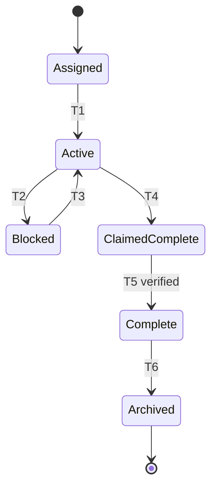

# State Machine Specification

Status: DRAFT v0.1 — Source: Programme Management Architecture v2.0 (Stage 1, Sprint 2)

## 1. Purpose

Define the formal lifecycle of a work item, the legal transitions, who may perform each, and what evidence each requires. Illegal transitions are rejected.

## 2. States

| State | Meaning |
|---|---|
| `Assigned` | Created/assigned; work not yet started. Initial state. |
| `Active` | Worker has started; activity recorded. |
| `Blocked` | Worker cannot proceed; block reason recorded. |
| `Claimed Complete` | Worker asserts completion and has attached evidence. Not yet verified. |
| `Complete` | Done criterion verified. |
| `Archived` | Closed out; terminal. |

## 3. Transition Table

| # | From | To | Trigger | Actor | Required Evidence |
|---|---|---|---|---|---|
| T1 | Assigned | Active | Worker starts work | Worker | Activity recorded |
| T2 | Active | Blocked | Worker cannot proceed | Worker | Block reason |
| T3 | Blocked | Active | Blocker removed | Worker / Manager | Block resolved |
| T4 | Active | Claimed Complete | Worker claims done | Worker | Evidence reference |
| T5 | Claimed Complete | Complete | Verification passes | Verification process | Done criterion satisfied |
| T6 | Complete | Archived | Closure rule met | Manager / System | Closure rule |

Any transition not listed is illegal and must be rejected without mutating the register.

## 4. Rules

1. Only the listed actors may perform a transition; actor identity is recorded in the audit log.
2. Only the verification process may produce `Complete`. Workers and managers cannot set it directly.
3. A failed verification does **not** change state: the item stays in `Claimed Complete` and a Verification Failure exception is raised (Exception-Detection Spec).
4. Every accepted transition writes one audit entry atomically with the state change and updates `last_update_ts`.
5. `Archived` is terminal.

## 5. Transition Request Contract

Input: `work_id`, `to_state`, `actor`, `evidence` (per table). Output: accepted (new state + audit_id) or rejected (reason code: `ILLEGAL_TRANSITION`, `ACTOR_NOT_PERMITTED`, `EVIDENCE_MISSING`, `NOT_FOUND`). Rejections do not mutate the register.

## 6. Acceptance Criteria (Sprint 2)

- Illegal transitions are rejected.
- Valid transitions are accepted.
- All transitions are audited.

## 7. Open Questions

1. How does a `Claimed Complete` item recover after failed verification (e.g. `Claimed Complete → Active`)? Not in source; proposed as an addition.
2. Definition of the T6 "closure rule".
3. What counts as "Activity recorded" for T1?
4. Should T1 be rejected when `assigned_to` is null? Proposed: yes.
5. Should rejected transitions be logged separately?
